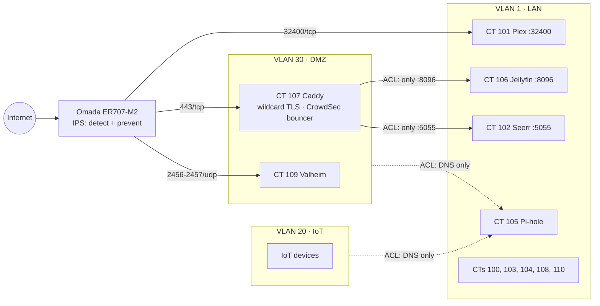
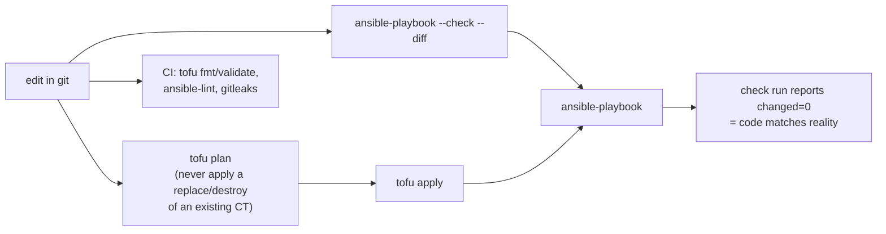
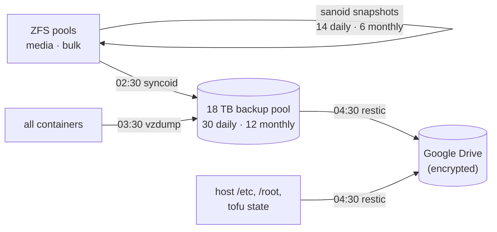

# homelab-as-code

A single-node Proxmox home lab where everything except app data is defined in code:
**OpenTofu** creates the containers, VLAN placement, GPU passthrough and DNS records;
**Ansible** configures the host and every container; secrets live in **Ansible Vault**.
A destroyed container comes back with `tofu apply`, one playbook run and a data restore.
The last drill took **4 min 47 s** from "disk gone" to "fully running".

This is a sanitized, read-only mirror of a private repo, published by
[`scripts/publish-public.sh`](scripts/publish-public.sh). Domains are swapped for
`example.*`, the vault is replaced by [`vault.example.yml`](ansible/group_vars/all/vault.example.yml)
(key names only), and live-config snapshots stay private.

## What runs on it

| CT | Service | Notes |
|---|---|---|
| 100 | Samba file shares | bind mounts from the ZFS pools |
| 101 | Plex | |
| 102 | Gluetun VPN, qBittorrent, Prowlarr, Radarr, Sonarr, Seerr, DoplarrRS | requests via website or Discord bot |
| 103 | Omada SDN controller | manages the router, switch and access points |
| 104 | Prometheus, Grafana, Uptime Kuma, pve-exporter | dashboards and alert rules provisioned from this repo |
| 105 | Pi-hole v6 + Unbound | whole-house DNS for every VLAN, split-horizon for the public names |
| 106 | Jellyfin | NVENC transcoding on a passed-through RTX 2060 Super |
| 107 | Caddy + CrowdSec | the only web entry point, on the DMZ |
| 108 | Stardew Valley server | |
| 109 | Valheim server + Cloudflare DDNS | on the DMZ |
| 110 | Ollama + Open WebUI | local models on the GPU, cloud models via OpenRouter (separate ZDR-only key for private chats) |

Host: Ryzen 9 3900X, 64 GB RAM, NVMe boot pool, three ZFS data pools (media, bulk, an 18 TB backup
target). Containers 100–104 are privileged (bind mounts, Docker); 105–110 are unprivileged.

## Network



Gateway ACLs deny DMZ and IoT traffic into the LAN except the arrows above. Public names are
Cloudflare records kept current by a DDNS container; at home, Pi-hole answers the same names
with the internal addresses, so traffic never hairpins through the router.

## How changes are made



- [`tofu/`](tofu): one resource per container, pinned IDs/MACs/IPs, Cloudflare DNS (SPF/DMARC "no mail"
  records for domains that never send email). Imported from the running system; no plan diff.
- [`ansible/`](ansible): 17 roles, one play per container, run from the host. Config is managed;
  app data (libraries, databases, metrics) is not, and comes back from backups.
- Grafana is fully provisioned: data source with a pinned UID, dashboards as JSON, alert rules,
  notification policy and the Discord contact point (webhook from the vault). Rules are locked in
  the UI, so the repo is the only place they change.

## Backups



The replication and offsite jobs each report to an Uptime Kuma push monitor; Proxmox's own
notifications (vzdump and the rest) go to Discord.

## Disaster recovery

Rebuilding one container (drilled on the monitoring CT):

| Step | | Time |
|---|---|---|
| 1 | Protected vzdump of the CT (or use the newest nightly) | 1:42 |
| 2 | Container destroyed (the simulated loss) | 4 s |
| 3 | `tofu apply`: 1 to add, same ID, MAC and IP | 6 s |
| 4 | Remove the old SSH host key | — |
| 5 | `ansible-playbook site.yml --limit monitoring` on the blank container | 66 s |
| 6 | Extract the app data dirs from the vzdump (`tar --numeric-owner`) | 30 s |
| 7 | Verify: all targets up with history, dashboards, 9 provisioned alert rules, 19/19 monitors, check run `changed=0` | ~2 min |

Lessons from that drill are in the commit history: IDs of imported containers weren't pinned
(a rebuild would have come back under a new ID), a same-day manual vzdump makes retention prune the
nightly one, and a provisioning file Grafana can't read takes all of Grafana down.

## Monitoring and security

- Prometheus scrapes the host (node-exporter, ZFS, SMART), Proxmox and CrowdSec; Grafana alerts on
  pool health and capacity, SMART changes, stale collectors and any scrape target down.
- Uptime Kuma watches every service and every backup job. A script on a separate desktop watches
  the host itself, and a hardware watchdog reboots it if the kernel hangs.
- Internet-facing: router IPS in prevent mode, CrowdSec bouncer inside Caddy, everything public on a
  DMZ VLAN. The only LAN ports reachable from outside are Jellyfin and Seerr (through the proxy only)
  and Plex's own port.
- Secrets: Ansible Vault in the repo, rendered to `0600` files on the hosts; a gitleaks scan of the
  full history runs in CI and before every publish.

## Layout

```
tofu/        OpenTofu: containers, GPU passthrough, Cloudflare DNS
ansible/     inventory, site.yml, 17 roles, group_vars (vault.example.yml here)
scripts/     publish-public.sh, collect.sh (live-config snapshot with secrets scrubbed),
             tofu-env.sh, media-library maintenance scripts
.github/     CI
```

Running it yourself means adapting a lot (IPs, MACs, storage names, bind mounts), but each role is
small and readable. MIT licensed.
